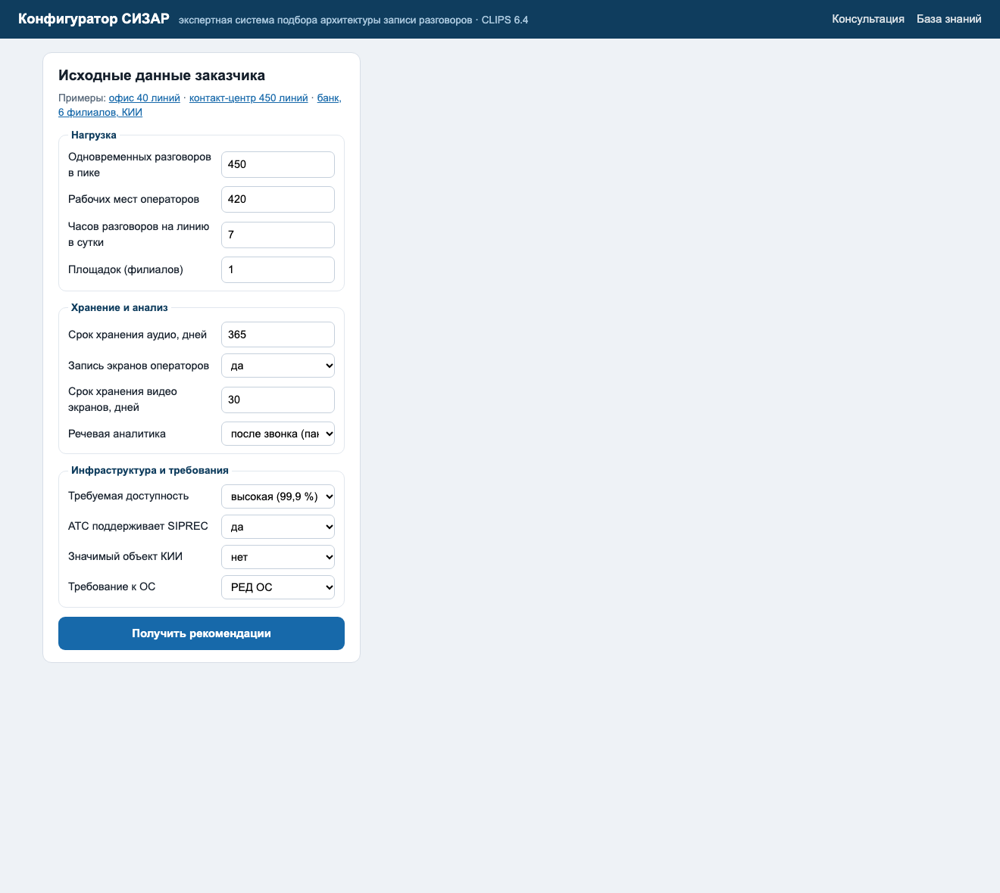
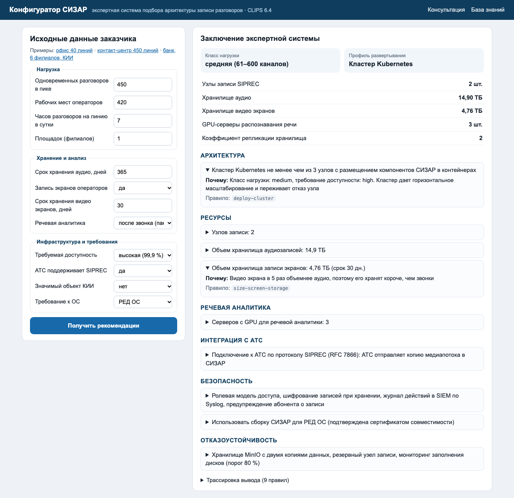
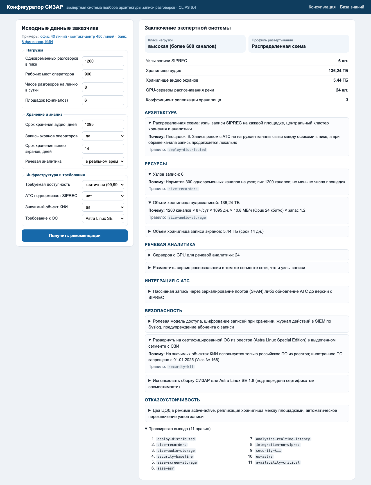

# Конфигуратор СИЗАР — прототип экспертной системы

Учебный проект производственной (технологической) практики, кейс-задача № 3.
Экспертная система помогает инженеру по внедрению подобрать архитектуру развертывания системы записи
разговоров и речевой аналитики СИЗАР на серверах заказчика: профиль установки, число узлов записи,
объем хранилища, серверы распознавания речи, способ подключения к АТС, меры защиты и отказоустойчивости.

## Предметная область

При подготовке коммерческого предложения инженер вручную оценивает нагрузку, срок хранения записей,
требования к доступности и безопасности. Знания об этом разбросаны по опыту отдельных специалистов,
а ошибка в объеме хранилища или в способе подключения к АТС выясняется только на пилоте. Экспертная система
формализует эти знания в виде правил и объясняет каждую рекомендацию.

## Оболочка и механизм вывода

- **CLIPS 6.4** (через библиотеку `clipspy`) — продукционная оболочка с прямым выводом (алгоритм Rete),
  шаблоны фактов `deftemplate`, приоритеты правил `salience`, функции `deffunction`.
- Знания хранятся отдельно от программы: `kb/sizar.clp` (22 правила, 6 нормативов). Изменить норматив
  или добавить правило можно без изменения кода на Python.
- `es/engine.py` загружает базу знаний, добавляет факт `request` с данными заказчика, запускает вывод и
  собирает факты `profile`, `metric`, `advice`.
- `es/__init__.py` — веб-интерфейс на Flask: форма ввода, заключение, объяснение «Почему» и имя
  сработавшего правила для каждой рекомендации, трассировка вывода, просмотр базы знаний.

## Структура базы знаний

| Группа | Правила | Что выводят |
|---|---|---|
| Классификация нагрузки | `load-small`, `load-medium`, `load-large` | класс по пиковому числу каналов (≤ 60, 61–600, > 600) |
| Профиль развертывания | `deploy-distributed` (salience 20), `deploy-cluster` (10), `deploy-compact` | компактная установка / кластер Kubernetes / распределенная схема |
| Расчет ресурсов | `size-recorders`, `size-audio-storage`, `size-screen-storage`, `screens-without-operators` | узлы записи, объем аудио и видео |
| Речевая аналитика | `size-asr`, `analytics-realtime-latency` | GPU-серверы распознавания, размещение |
| Интеграция с АТС | `integration-siprec`, `integration-no-siprec` | SIPREC или зеркалирование портов |
| Безопасность | `security-baseline`, `security-kii`, `os-astra`, `os-redos` | 152-ФЗ, КИИ, требования к ОС |
| Отказоустойчивость | `availability-high`, `availability-critical`, `availability-compact-warning` | репликация, резервирование, резервные копии |
| Проверка противоречий | `conflict-compact-large-retention` | предупреждение о несоответствии профиля объему |

Нормативы (`deffacts norms`): аудио Opus 24 кбит/с — 10,8 МБ/ч; видео экрана 1 кадр/с — 54 МБ/ч;
300 каналов на узел записи; 150 каналов на GPU при пакетной расшифровке и 50 — в реальном времени; запас 20 %.

## Запуск

```bash
python3 -m venv .venv && source .venv/bin/activate
pip install -r requirements.txt
flask --app es run          # http://127.0.0.1:5000
```

## Тестирование

```bash
python3 -m unittest discover -s tests -t . -v
```

12 тестов: загрузка базы знаний, эталонные сценарии (офис на 40 линий, контакт-центр на 450 линий, банк с
6 филиалами на объекте КИИ), граничные значения 60/61 канал, однократное срабатывание правил, противоречивые
данные, проверка ввода, форматирование чисел, веб-интерфейс.

| Сценарий | Ожидаемый вывод эксперта | Результат системы |
|---|---|---|
| 40 линий, 1 площадка, стандартная доступность | компактная установка, 1 узел, 0,56 ТБ | совпадает |
| 40 линий, высокая доступность | кластер, 2 узла, репликация ×2 | совпадает |
| 450 линий, запись экранов, пакетная аналитика | кластер, 2 узла, 14,9 ТБ аудио, 4,76 ТБ видео, 3 GPU | совпадает |
| 1200 линий, 6 филиалов, КИИ, без SIPREC | распределенная схема, 6 узлов, 136,24 ТБ, 24 GPU, Astra Linux, SPAN | совпадает |

## Найденные при отладке ошибки

| Ошибка | Устранение |
|---|---|
| Для одного запроса срабатывали и `deploy-cluster`, и `deploy-distributed` — в заключении было две архитектуры | приоритеты `salience` и условие `(not (profile))` в правилах профиля |
| Деление `/` в CLIPS дает дробь, число узлов получалось 1,5 | функция `ceil-div` на основе `div` и `mod` |
| При 0 операторов и включенной записи экранов объем видео был 0 ТБ без пояснения | отдельное правило-предупреждение `screens-without-operators` |
| Замена точки на запятую портила даты и версии («01,01,2025», «1,8») | запятая ставится только у величин с единицами измерения |
| Пустое поле формы приводило к ошибке CLIPS при добавлении факта | проверка ввода в Python до обращения к CLIPS |

## Рекомендации по развитию

Коэффициенты уверенности для неточных исходных данных; модуль приобретения знаний (редактор нормативов
для экспертов без программирования); выгрузка заключения в PDF для коммерческого предложения; расчет
стоимости оборудования по прайс-листу; интеграция с CRM для хранения конфигураций заказчиков.

## Снимки экрана




